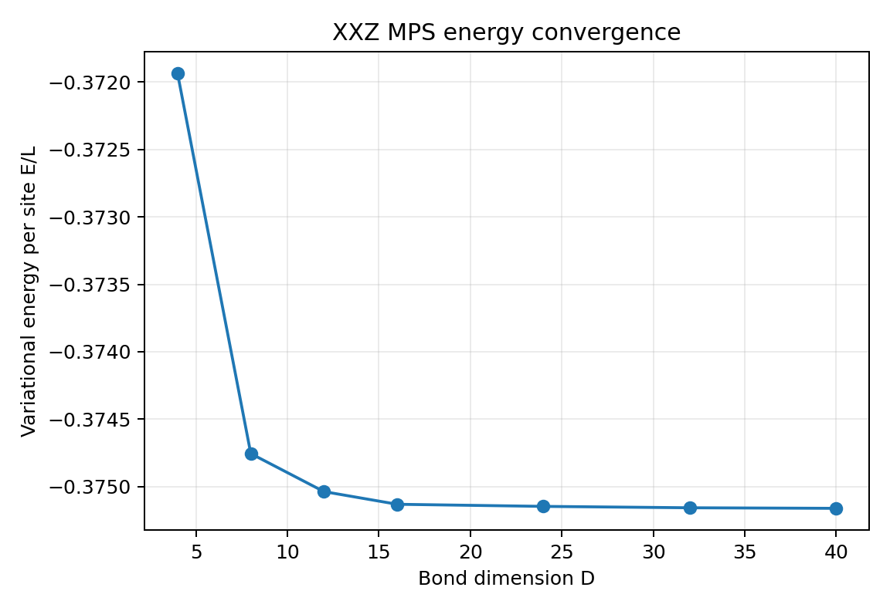
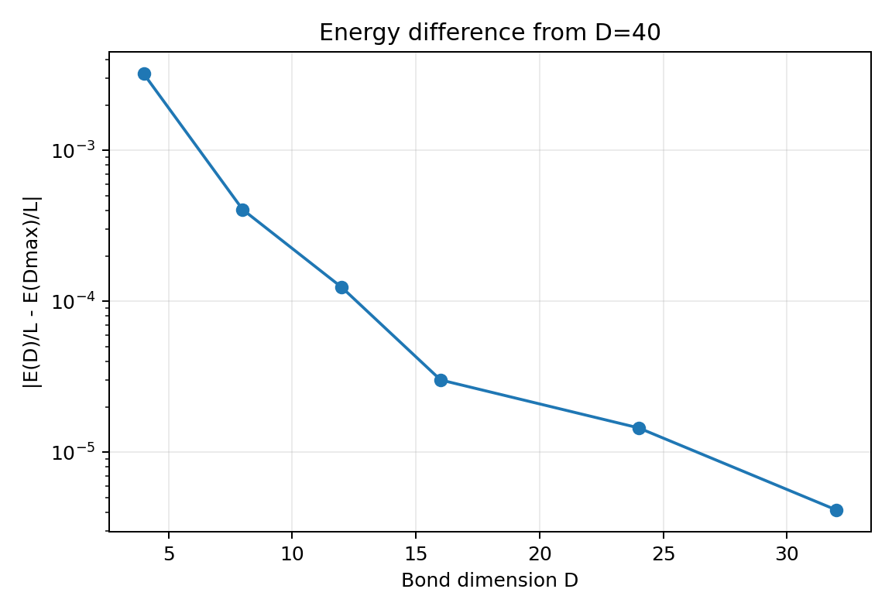
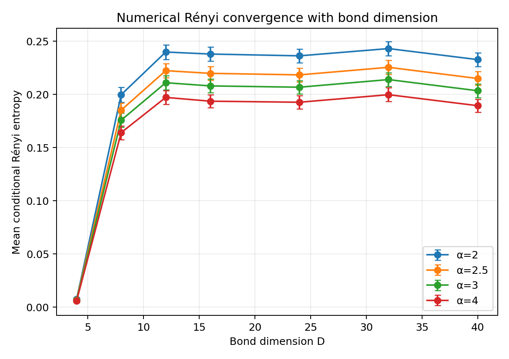
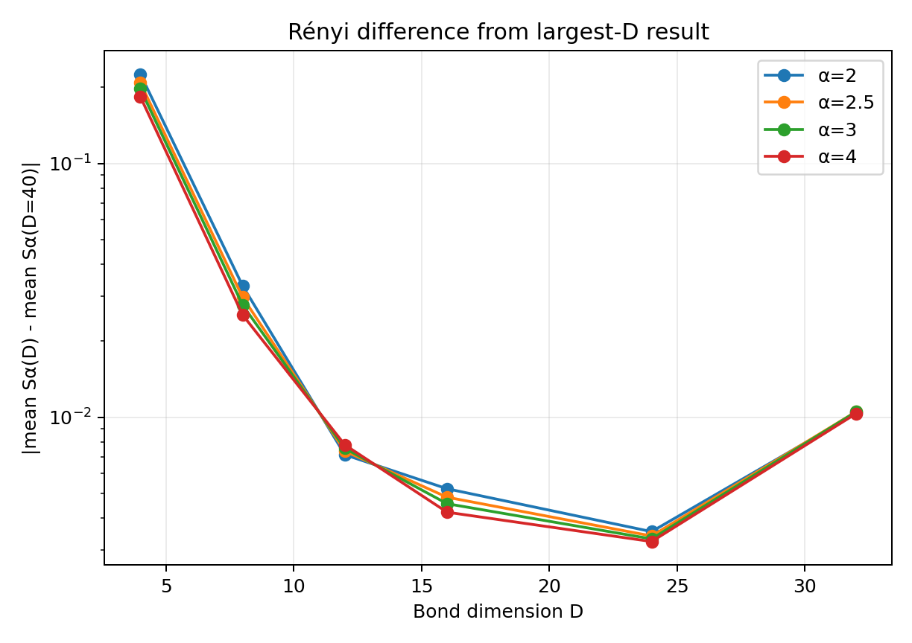
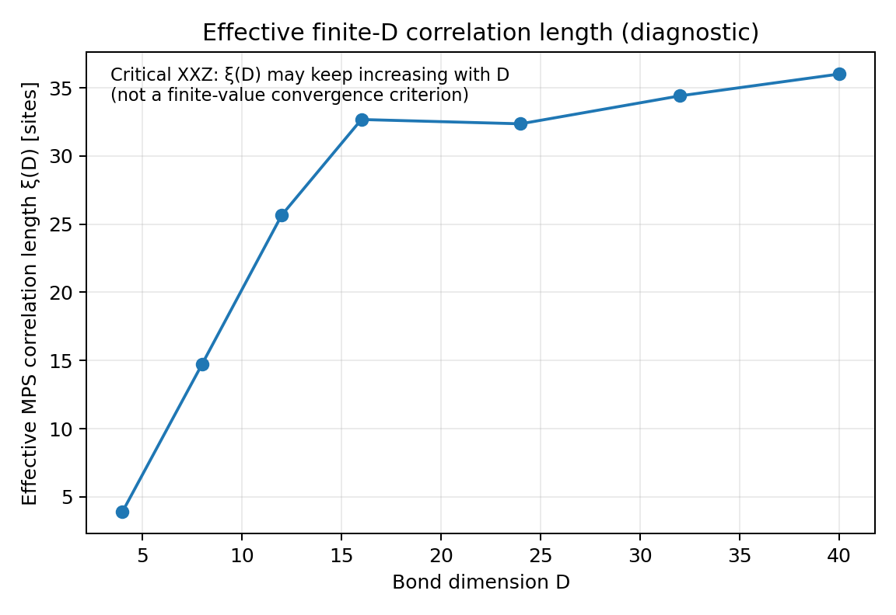
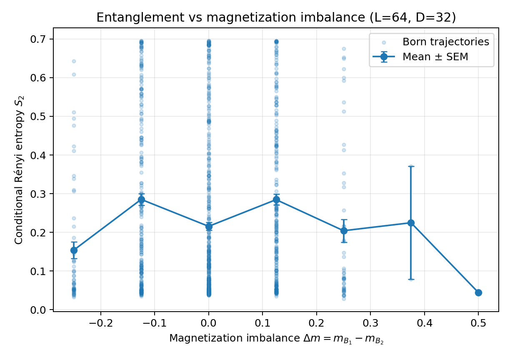
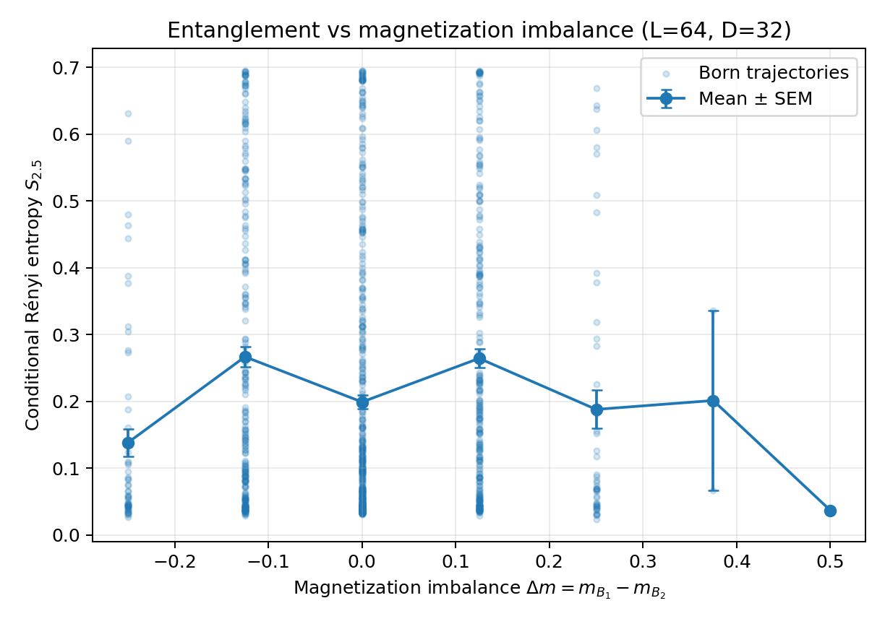
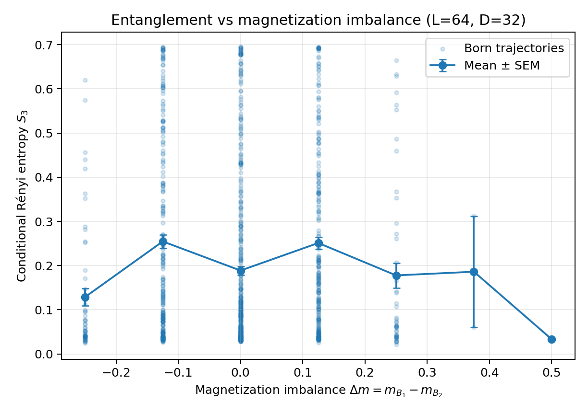
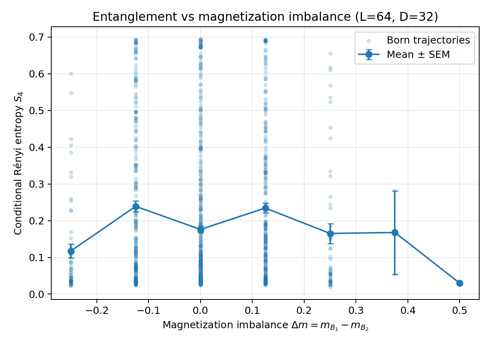

# Numerical XXZ MPS study

A numerical study of the periodic spin-1/2 XXZ chain using a two-site, U(1)-symmetric matrix product state (MPS).

This repository contains only the lattice/MPS calculation: variational ground-state optimization, bond-dimension convergence, Born sampling of projective measurements, conditional Schmidt spectra, and Rényi entropies. No continuum or CFT prediction is evaluated.

## Model

The Hamiltonian is

\[
H=\sum_{j=1}^{L}\left(S_j^xS_{j+1}^x+S_j^yS_{j+1}^y+\Delta S_j^zS_{j+1}^z\right),
\qquad S_{L+1}\equiv S_1,
\]

with the production results in this repository generated at

- `L = 64`
- `Delta = 0.5`
- two-site periodic U(1)-symmetric MPS
- bond dimensions `D = 4, 8, 12, 16, 24, 32, 40`
- `1000` Born trajectories per bond dimension for the post-measurement analysis.

The measurement geometry is

\[
(A_1,B_1,A_2,B_2)=(L/8,L/4,3L/8,L/4),
\]

so for `L=64` the block lengths are `(8,16,24,16)`. Spins in `B1` and `B2` are measured in the computational / `S^z` basis. For each measurement record, the code computes the conditional Schmidt spectrum of `A1|A2` and the Rényi entropies

\[
S_\alpha=\frac{1}{1-\alpha}\log\sum_i p_i^\alpha,
\qquad \alpha\in\{2,2.5,3,4\}.
\]

## Magnetization imbalance `delta_m`

For each measured block define the extensive lattice magnetization

\[
M_{B_r}=N_\uparrow(B_r)-N_\downarrow(B_r),
\]

and its density

\[
m_{B_r}=\frac{M_{B_r}}{|B_r|}.
\]

The quantity plotted in `plots/delta_m/` is

\[
\boxed{\Delta m=m_{B_1}-m_{B_2}}.
\]

Thus `Delta m` is simply the magnetization-density imbalance between the two measured regions. It is computed directly from the sampled spin outcomes. For `L=64`, both measured blocks contain 16 sites.

Every trajectory CSV includes

- `M_B1`, `M_B2`
- `m_B1`, `m_B2`
- `delta_m`
- `m_measured_total`
- the conditional Rényi entropies.

## Why `D=32` is used

The largest comparison point is `D=40`, so `D=32` is tested against a larger variational space rather than being declared converged simply because it is the largest calculation.

For the optimized `L=64` states,

| D | E/L | |e_AB - e_BA| | xi(D) |
|---:|---:|---:|---:|
| 4 | -0.3719368501 | 1.70e-1 | 3.91 |
| 8 | -0.3747553294 | 5.01e-2 | 14.74 |
| 12 | -0.3750372694 | 8.49e-3 | 25.67 |
| 16 | -0.3751312071 | 1.73e-3 | 32.68 |
| 24 | -0.3751468440 | 1.05e-3 | 32.37 |
| **32** | **-0.3751572139** | **6.11e-4** | **34.42** |
| 40 | -0.3751613560 | 3.67e-4 | 36.02 |

The energy-per-site change between `D=32` and `D=40` is

\[
|e_{32}-e_{40}|=4.14\times10^{-6},
\]

below the repository's stated `1e-5` energy tolerance.

For the sampled conditional Rényi entropies, the `D=32` and `D=40` mean values differ by about `0.0103-0.0105`, but these differences are only about `1.1` combined standard errors with 1000 trajectories. Therefore `D=32` is numerically supported at the resolution of this run. This is a convergence criterion for the observables tested here, not a rigorous proof of exact convergence; a higher-statistics or more tightly optimized run can be used for a stronger check.

The transfer-matrix correlation length is **not** used as a convergence criterion. At `Delta=0.5` the XXZ chain is critical in the thermodynamic limit, so the exact correlation length is not expected to saturate to a finite value. A finite-bond-dimension MPS instead has an effective correlation length `xi(D)` that generally grows as `D` is increased. The included `xi(D)` figure is therefore a diagnostic of increasing long-range correlation capacity, not evidence that `D=32` is converged because `xi(D)` has flattened.

## Figures

### Bond-dimension convergence of tested observables









### Transfer-matrix diagnostic



For this critical model, increasing `xi(D)` with bond dimension is expected. It should not be interpreted as a quantity that must converge to a finite plateau. See [`docs/CORRELATION_LENGTH.md`](docs/CORRELATION_LENGTH.md) for the interpretation used in this repository.

### Entanglement versus magnetization imbalance at D=32

Each figure shows the individual Born trajectories and the mean ± SEM at each discrete value of `Delta m`.









## Repository structure

```text
xxz-mps-numerical-study/
├── README.md
├── requirements.txt
├── .gitignore
├── src/
│   └── xxz_mps_study.py
├── scripts/
│   ├── analyze_existing_results.py
│   └── run_L64_production.sh
├── data/
│   ├── summary/
│   │   ├── bond_dimension_summary.csv
│   │   ├── renyi_summary.csv
│   │   ├── delta_m_summary.csv
│   │   └── convergence_report.json
│   └── trajectories/
│       └── D_*/
│           ├── trajectory_results.csv
│           ├── renyi_summary.csv
│           └── metadata.json
├── plots/
│   ├── convergence/
│   ├── diagnostics/
│   └── delta_m/
├── results/
│   └── mps/D_*/optimized_mps.npz
└── docs/
    ├── METHOD.md
    ├── RESULTS.md
    └── CORRELATION_LENGTH.md
```

## Installation

```bash
python -m venv .venv
source .venv/bin/activate
pip install -r requirements.txt
```

## Reproduce the L=64 production run

```bash
bash scripts/run_L64_production.sh
```

or directly

```bash
python src/xxz_mps_study.py \
  --L 64 \
  --Ds 4 8 12 16 24 32 40 \
  --records 1000 \
  --candidate-D 32 \
  --output output/L64_D_convergence
```

The main program automatically writes the `delta_m` columns, `delta_m_summary.csv`, and the separate entanglement-versus-`delta_m` figures.

## Numerical notes

- The energy is evaluated through symmetry-resolved MPS transfer-matrix contractions; the full many-body Hamiltonian matrix is never constructed.
- The MPS tensors are optimized variationally with Adam followed by L-BFGS.
- The effective finite-D correlation length is obtained from the leading transfer-matrix eigenvalues and is reported as a diagnostic; it is not used to decide bond-dimension convergence for this critical model.
- Measurement outcomes are Born sampled from the MPS.
- Conditional Schmidt spectra are evaluated in charge blocks and converted directly to Rényi entropies.
- The results in `data/` and `plots/` are the saved `L=64` production run included with the repository.
